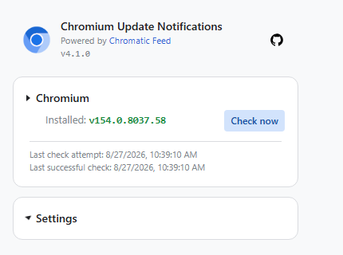

# Chromium Update Notifications

Chromium Update Notifications is a Manifest V3 extension for independently
distributed Chromium builds without a built-in updater. It reads a normalized,
cryptographically signed multi-source feed and displays a badge when a newer
version—or optionally a newer snapshot revision—is available.

It can also check installed extensions for updates and provide basic extension
management where Chromium permits it.



## Current development status

- The current stable release is Manifest V3 version 4.1.0.
- Version 4.0.0 is retired: it cannot verify the currently signed production
  feed. Update to 4.1.0; unpacked installations must be reloaded from current
  source.
- Planned feed-signing key rotation is based on a 12-month maximum active
  signing lifetime, not each extension release. A new client must be available
  for a 30-day migration before the signer changes; acceptance of the outgoing
  key ends at that cutover. Version 4.1.0 predates client-side expiry,
  so this limit requires a future extension release. A compromised key instead
  requires immediate replacement and an emergency extension release, without
  a grace period.
- Build data comes from the separate [Chromatic Feed](https://github.com/Bone06/chromatic-feed)
  aggregator, not
  directly from Woolyss or individual build repositories.
- Feed bytes are verified with an embedded ECDSA P-256 public key before JSON
  parsing and strict schema validation.
- The extension uses the signed production HTTPS feed and revalidates it with
  ETag / `If-None-Match`; unchanged `304` responses retain the previously
  verified local cache.
- Conditional cache reuse also requires a currently trusted signing key and
  a feed generated within the last three hours. Older cached data is retained
  with an error/stale warning; a generation time more than five minutes in the
  future is rejected without advancing rollback protection.
- The update manifest targets the 4.1.0 CRX asset from this repository's
  [latest GitHub release](https://github.com/Bone06/chromium-notifier/releases/latest).

## Features

- signed Chromium build metadata and HTTPS download links;
- Windows x64/ARM64, macOS Intel/Apple Silicon and Linux x64 builds;
- optional snapshot revision notifications;
- manual update checks and distinct Chromium/extension/error badge states;
- optional installed-extension update tracking;
- enable, disable and remove extension actions where allowed;
- custom badge colors;
- light, dark and browser-default popup themes;
- independent Chromium blue (default) and Teal accent palettes, saved locally;
- cached data and per-source stale/error reporting;
- conditional ETag feed requests to avoid downloading unchanged metadata.

Tracking arbitrary extension update servers requires the broad HTTP/HTTPS host
permissions declared in `manifest.json`. This is an intentional compatibility
trade-off and must be reviewed before distribution.

## Installation

1. Review the source code.
2. Download the [.crx file from the latest release](https://github.com/Bone06/chromium-notifier/releases/latest/download/chromium-notifier.crx).
3. Navigate to `chrome://extensions`.
4. Drag and drop the CRX file into the browser window.

### Load unpacked

If Chromium blocks external CRX installation, clone or unpack the repository,
open `chrome://extensions`, enable Developer mode, choose **Load unpacked**, and
select the project directory.

An unpacked installation does not follow the normal CRX update path. After a
Git update, use the extension tile's reload action.

Some Chromium builds require
`chrome://flags/#extension-mime-request-handling` to be set to **Always prompt
for install** for one-click external extension installation.

## Configuration

Open the popup and select a platform and build. Settings also include extension
update tracking, snapshot revision notifications, theme mode, interface color
(Chromium blue or Teal) and custom badge colors. `Check now` performs an immediate refresh.

## Development

```text
npm ci
npm run check
npm run package
```

Runtime JavaScript and third-party UI libraries are bundled locally. npm
dependencies are development tools and are not loaded by the extension.

### Browser regression tests

```text
npm run test:browser:install
npm run test:browser
```

Playwright uses disposable, isolated Chromium contexts and a loopback-only HTTP
fixture with simulated extension APIs. No normal browser profile, real extension
storage or production feed is touched. An existing Playwright browser cache can
be selected with `PLAYWRIGHT_BROWSERS_PATH`; no reinstall is needed in that case.
The CI browser job installs Chromium and its Linux system dependencies separately.

The suite checks both interface palettes in light/dark mode with axe, distinct
picker highlights, long names/errors, theme persistence and browser-theme changes,
snapshot acknowledgment, missing selection and UI recovery after a simulated
failed check. Failures retain a trace and screenshot in `test-results/`.
These are rendering tests, not an installed-extension/service-worker end-to-end
test; request, signature and worker behavior are covered separately by `npm run check`.

### Runtime organization

`js/core.js` preserves the existing public exports while feed validation,
extension updates, version handling, URLs and badge formatting live in focused
modules. `js/presentation.js` derives the shared popup/badge state without writing
to storage. The open popup's snapshot notice is intentionally retained locally
until the popup closes, even after its storage acknowledgment clears the badge.
Popup cards and setting events live under `js/popup/`; `js/popup.js` owns lifecycle,
extension actions and state synchronization. Existing storage names remain compatible.

The embedded feed public keys and production URL belong to this project's
deployment. To run an independent fork, generate your own feed-signing key
pair, point `BUILD_FEED_URL` in `js/background.js` to your feed, and replace
`TRUSTED_FEED_KEYS` in `js/feed-signature.js` with your public key. The private
feed key is not included in the clone and must never be committed or published.

Popup styles are authored in `styles.scss`, with shared theme tokens and mixins
under `scss/`. Run `npm run build:css` after an SCSS change and commit the
generated `styles.css` with it. `npm run check` rejects stale generated CSS,
and the release package intentionally contains only `styles.css`, not the SCSS
sources or Sass tooling.

`npm run package` recreates `build/chromium-notifier` from the explicit
`release-files.json` allowlist. The staging directory contains only runtime
assets and required license notices; tests, development dependencies, source
documentation and repository metadata are excluded. Use this staged directory
when creating a signed CRX with the established private signing key. The key
must remain outside the repository, staging directory and release artifacts.

Chromium consequently writes the signed package as
`build/chromium-notifier.crx`. Every GitHub release must upload that file with
both its asset filename and display label set exactly to
`chromium-notifier.crx`; the stable update URL and existing installations rely
on that version-independent name.

## Origin and attribution

This maintained project is based on [Christian Mund's original Chromium Update
Notifications](https://github.com/kkkrist/chromium-notifier). The original
author and license information remain in `manifest.json` and `COPYING.txt`;
bundled libraries are credited in `THIRD_PARTY_NOTICES.txt`.

The original project's [2023 retirement notice and legacy
instructions](https://github.com/kkkrist/chromium-notifier/blob/v2.0.0/README.md)
describe the historical upstream, not this maintained Manifest V3 release.
Its version 1.x and 2.0.0 tags remain available here as historical references.
